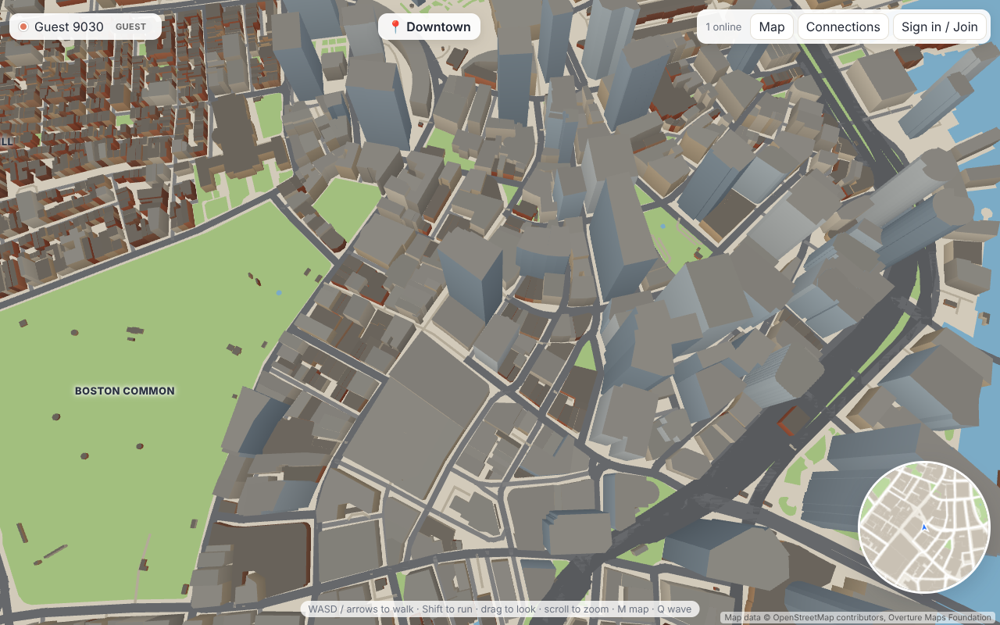

# Social Web: Boston & Cambridge

Walk around a 3D Boston and Cambridge, run into other people in real time, and connect with the ones you meet.

- **Everyone** gets a 3D character on arrival and can roam the city, see everyone else live, and use the map to travel.
- **Guests** can explore and watch, but can't interact.
- **Members** (free account) can send a connection request to another member when they're standing near each other (within 30 m), accept or decline requests, wave (Q), and find their connections on the map ("Go to").



## Run it locally

Requires **Node.js 22.13 or newer** (it uses the built-in `node:sqlite`).

```bash
npm install
npm run build     # builds the client into dist/
npm start         # http://localhost:3000
```

For development with hot reload (Vite on :5173, API/WebSocket server on :3000):

```bash
npm run dev       # open http://localhost:5173
```

Run the server test (registration, login, presence, guest limits, distance rule, request/accept flow):

```bash
npm test
```

To try the multiplayer side on one machine, open the site in two different browsers (or a normal and a private window), create an account in each, and walk the two characters together. Both start on Boston Common.

### Controls

| Action | Keys |
| --- | --- |
| Walk / run | WASD or arrows, hold Shift to run |
| Look around / zoom | Drag, mouse wheel |
| Map and fast travel | M (or click the minimap) |
| Connections | C |
| Wave (members) | Q |
| Touch devices | On-screen joystick |

## How it works

```
client/            three.js + Vite front end
  src/world.js     builds the city meshes from data/city.json, plus a collision grid
  src/avatar.js    original low-poly character built from primitives
  src/main.js      game loop, camera, input, HUD, auth and connections UI
  src/minimap.js   minimap and full map with click-to-travel
  src/net.js       WebSocket client and fetch helper
  public/data/city.json   preprocessed map (≈6 MB, ≈2 MB gzipped)
server/
  index.js         Express API, static hosting, session cookies
  realtime.js      WebSocket presence (10 Hz snapshots) and in-world connection requests
  db.js            SQLite schema and queries (users, connection_requests)
  auth.js          scrypt password hashing, HMAC-signed session tokens
scripts/           Python pipeline that produced city.json from Overture Maps
tests/             node:test end-to-end server test
```

- **Accounts:** usernames are case-insensitive and unique; passwords are hashed with scrypt; the session is an HMAC-signed, httpOnly cookie that the WebSocket also reads on connect.
- **Presence:** each browser holds one WebSocket. Clients send their position about 10 times a second while moving; the server broadcasts compact snapshots at 10 Hz and the client interpolates. One live avatar per account (a new tab replaces the old one). Members' last position is saved, so they come back where they left off.
- **Connecting:** the server, not the client, enforces the rules: both people must be members, within 30 m of each other, and not already connected or pending. If the other person already sent you a request, connecting accepts it. Each connection remembers where you met ("Met near Kendall Square").

### Configuration

| Variable | Default | Purpose |
| --- | --- | --- |
| `PORT` | `3000` | HTTP and WebSocket port |
| `DB_FILE` | `data/social-web.db` | SQLite file |
| `SESSION_SECRET` | generated into `data/.session-secret` | Signs session cookies; set it explicitly in production |
| `NODE_ENV` | | Set to `production` to mark cookies `Secure` (needs HTTPS) |

## Map data

Buildings (with heights), roads, water and parks for roughly lon −71.13…−71.02, lat 42.33…42.395 come from the [Overture Maps](https://overturemaps.org) 2026-10-21 release, which is largely derived from OpenStreetMap. Data © OpenStreetMap contributors (ODbL) and Overture Maps Foundation; the attribution is shown in the app.

To regenerate or change the area, edit the bounding box in `scripts/` and run (needs Python with `pyarrow` and `shapely`):

```bash
python3 scripts/scan.py      # finds the Overture building row groups covering the box
python3 scripts/extract.py   # writes boston.parquet (update the row groups/file it prints)
python3 scripts/scan2.py     # water, roads, land use
python3 scripts/convert.py   # writes city.json -> copy to client/public/data/
```

## Known limits and next steps

- Everyone receives everyone's position. That's fine for hundreds of people; beyond that, add interest management (only send nearby players) and a binary protocol.
- The ground is flat and you can walk on water; bridges and terrain aren't modelled.
- No chat, blocking/reporting, email verification or password reset yet. Those are the next things to add before opening it to the public.
- Rate limiting is in-memory and per process.
